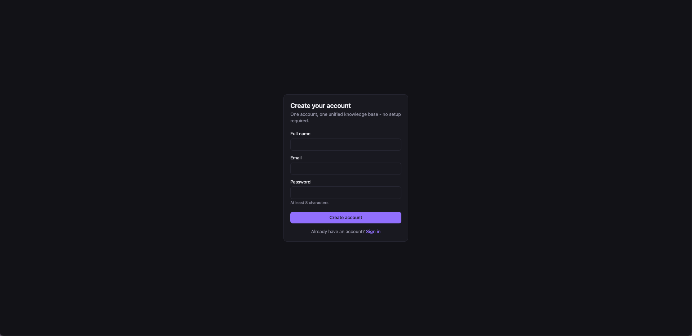
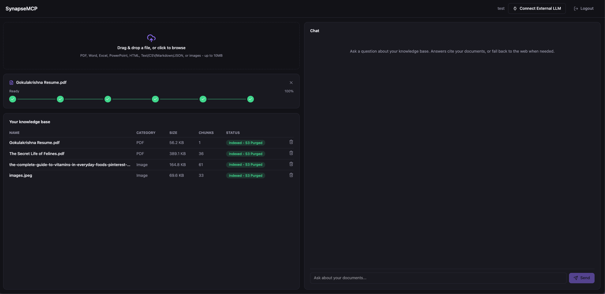
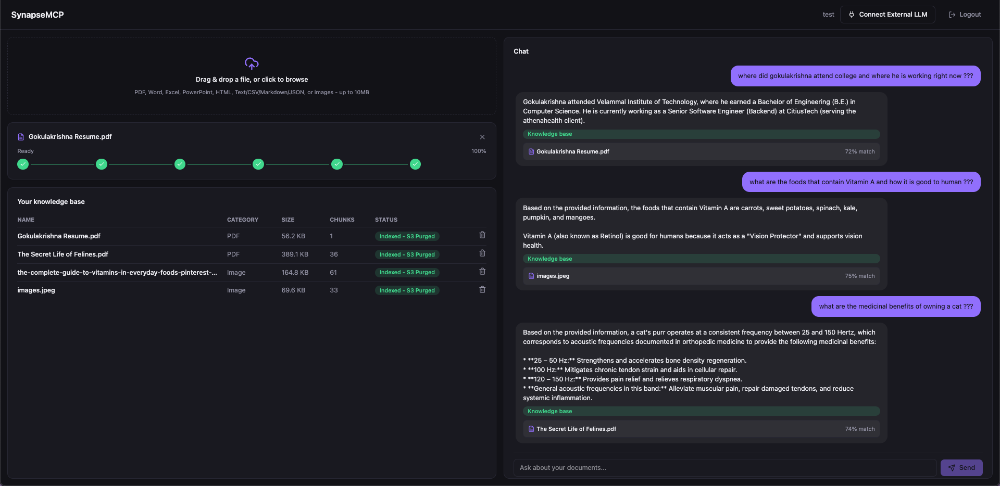
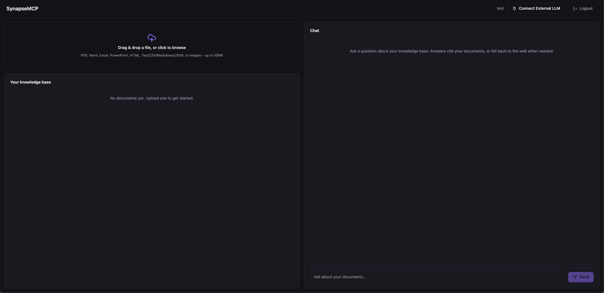

# SynapseMCP — Frontend

React 19 + TypeScript + Vite single-page application for **SynapseMCP**, a multi-tenant RAG platform. This is the primary web client: it handles sign-up/sign-in, unified knowledge-base document upload with dual-phase progress tracking, conversational RAG chat with citations, and MCP API key management for connecting external LLM clients (Claude Desktop, Cursor, etc.) to the user's private knowledge base.

This app is a standalone project — it is **not** nested inside the Spring Boot backend repo. It talks to the backend purely over `/api/v1/**` REST + SSE, with no other coupling.

---

## Screenshots

| Sign in | Sign up |
|---|---|
|  |  |

| Document upload & ingestion progress | Conversational RAG chat |
|---|---|
|  |  |

| Home / workspace |
|---|
|  |

---

## Tech stack

- **React 19** + **TypeScript** + **Vite 8**
- **Tailwind CSS 4** (via `@tailwindcss/vite`)
- **Axios** for HTTP, with a JWT request interceptor and 401 redirect handling
- **lucide-react** for icons
- **oxlint** for linting
- No router, no state-management library, no chart/markdown libraries — the app is intentionally dependency-light (see `package.json`)

---

## Core product constraints this UI reflects

These come directly from the platform's architecture (`plan.md` / `design.md` / `architecture.md` / `instruction.md`) and shape why the UI looks the way it does:

- **Exactly one knowledge base per user.** There is no KB picker, switcher, or management screen anywhere in the UI — every signed-in user has a single unified workspace.
- **No model configuration UI.** The backend's LLM and embedding models are fixed server-side; there are no model dropdowns or settings for it.
- **No raw file re-download.** Once a document is ingested, its original binary is purged from S3/MinIO server-side. The UI only ever shows extracted chunk text via citation cards — never a "download original file" action.
- **Dual-phase upload progress.** Every upload shows two back-to-back phases in one continuous UI: (1) network byte-upload percentage via Axios `onUploadProgress`, then (2) live backend ingestion stages (`QUEUED → PARSING → CHUNKING → EMBEDDING → PURGING_S3 → INDEXED`) via Server-Sent Events, with a polling fallback if the SSE connection drops.
- **Transient, client-only chat history.** Conversation turns live in React state for the lifetime of the tab/session only. Nothing is persisted to the backend; refreshing the page clears the conversation. The backend never stores chat transcripts.
- **MCP key management, not MCP usage.** The frontend only generates/lists/revokes MCP API keys and shows a copy-paste connection snippet (for Claude Desktop / Cursor); it does not itself act as an MCP client.

---

## Prerequisites

- Node.js 20+ (recommended for Vite 8 / React 19)
- The SynapseMCP Spring Boot backend running and reachable (default: `http://localhost:8080`)

---

## Getting started

```bash
npm install
npm run dev
```

The dev server runs on **http://localhost:5173**.

### Available scripts

| Command | Description |
|---|---|
| `npm run dev` | Start the Vite dev server with HMR on port `5173`. |
| `npm run build` | Type-check (`tsc -b`) and produce a production build in `dist/`. |
| `npm run preview` | Serve the production build locally for a final check. |
| `npm run lint` | Run `oxlint` over the project. |

---

## Environment variables

Configured via Vite env files (`.env.development` for local dev, `.env.example` as the template for other environments).

| Variable | Purpose | Default behavior if unset |
|---|---|---|
| `VITE_BACKEND_ORIGIN` | The backend's origin, used **only** to build the MCP connection URL shown in the "Connect External LLM" modal (`McpKeyModal.tsx`) after a key is generated. | Falls back to `window.location.origin` — correct only for a true same-origin production deployment (frontend and backend served from the same host behind a reverse proxy). |

**Why this exists:** external MCP clients (Claude Desktop, Cursor, CLI agents) are not the browser page — they connect to the backend directly over their own HTTP client and never go through Vite's dev-only `/api` proxy. In local dev the frontend (`:5173`) and backend (`:8080`) are different origins, so `window.location.origin` would produce a URL that 404s for any MCP client. Setting `VITE_BACKEND_ORIGIN=http://localhost:8080` in dev fixes this; it's safe to leave unset in a same-origin production deployment.

### Dev-time API proxying

`vite.config.ts` proxies `/api/**` to `http://localhost:8080` during `npm run dev`, so the browser never has to deal with CORS for the JWT-authenticated REST endpoints or the SSE ingestion-progress stream. This covers everything under `/api/v1/**` — it does **not** cover `/mcp/**`, which is why `VITE_BACKEND_ORIGIN` exists separately (see above).

```ts
server: {
  port: 5173,
  proxy: {
    '/api': { target: 'http://localhost:8080', changeOrigin: true },
  },
}
```

In production, configure your reverse proxy (Nginx, Cloudflare, etc.) to route `/api/**` to the backend; `/mcp/**` is only ever hit directly by external MCP clients, not by the browser.

---

## Project structure

```text
frontend/
├── public/
│   └── favicon.svg
├── src/
│   ├── assets/                        # Static images (screenshots above live here)
│   ├── components/
│   │   ├── common/
│   │   │   ├── Button.tsx
│   │   │   ├── Card.tsx
│   │   │   ├── Modal.tsx
│   │   │   ├── Badge.tsx
│   │   │   └── Toast.tsx
│   │   ├── layout/
│   │   │   ├── AppHeader.tsx          # User info, logout, "Connect External LLM" trigger
│   │   │   └── MainLayout.tsx         # Workspace layout (documents + chat)
│   │   ├── auth/
│   │   │   ├── LoginForm.tsx
│   │   │   └── SignupForm.tsx
│   │   ├── documents/
│   │   │   ├── DocumentUploadDropzone.tsx   # Drag & drop, 7 supported categories, client-side 10MB check
│   │   │   ├── FileUploadProgressCard.tsx   # Dual-phase progress UI (upload % + SSE ingestion stepper)
│   │   │   ├── IngestionStepper.tsx         # Visual step indicator (Upload → Parse → Chunk → Embed → Purged → Ready)
│   │   │   ├── DocumentTable.tsx            # Document list: name, size, category, status, delete
│   │   │   ├── DocumentFilter.tsx           # Filter uploaded documents by type/status
│   │   │   └── fileCategory.ts              # Maps file extension/MIME type to one of the 7 categories
│   │   ├── chat/
│   │   │   ├── ChatWindow.tsx
│   │   │   ├── MessageBubble.tsx
│   │   │   ├── CitationCard.tsx             # Local KB chunk citation (doc name, snippet, similarity score)
│   │   │   ├── WebSourceBadge.tsx           # Web-search fallback attribution
│   │   │   └── QueryRoutingIndicator.tsx    # "Searching knowledge base...", "Falling back to web search..."
│   │   └── settings/
│   │       └── McpKeyModal.tsx              # Generate/copy/revoke MCP API key + client config snippet
│   ├── context/
│   │   ├── AuthContext.tsx            # User/session state, JWT storage, login/logout
│   │   └── ToastContext.tsx           # Global toast notifications
│   ├── hooks/
│   │   ├── useDocuments.ts            # List/upload/delete documents
│   │   ├── useFileUploadWithProgress.ts  # Axios upload % → SSE ingestion stream, with polling fallback
│   │   ├── useRagChat.ts              # Send chat query, manage in-memory transient session history
│   │   └── useMcpKeys.ts              # Fetch/generate/revoke MCP API keys
│   ├── services/
│   │   ├── api.ts                     # Axios instance, JWT interceptor, 401 redirect
│   │   ├── authService.ts             # POST /api/v1/auth/signup, /signin
│   │   ├── documentService.ts         # Upload, list, progress-stream, delete
│   │   ├── chatService.ts             # POST /api/v1/chat
│   │   └── mcpKeyService.ts           # /api/v1/keys/mcp CRUD
│   ├── types/
│   │   ├── auth.ts
│   │   ├── document.ts
│   │   ├── chat.ts
│   │   └── mcp.ts
│   ├── index.css                      # Design tokens, Tailwind layer, theme
│   ├── App.tsx
│   └── main.tsx
├── .env.example
├── .env.development
├── vite.config.ts
├── tsconfig.json / tsconfig.app.json / tsconfig.node.json
└── package.json
```

---

## How the pieces fit together

### Authentication
`AuthContext` holds the current user and JWT, persists the token, and exposes `login`/`signup`/`logout`. `services/api.ts` wraps Axios with a request interceptor that attaches `Authorization: Bearer <token>` to every call, and a response interceptor that redirects to the sign-in screen on `401`.

### Document upload & ingestion progress
`DocumentUploadDropzone` accepts files across the 7 supported categories (PDF, Word, Excel, PowerPoint, HTML, Text/CSV/MD/JSON, Images) and rejects anything over 10MB client-side before it ever hits the network. `useFileUploadWithProgress`:

1. Posts the file via Axios `onUploadProgress` to drive **Phase 1** (network upload %, `FileUploadProgressCard`).
2. On `202 Accepted`, opens an `EventSource` against `GET /api/v1/documents/{id}/progress-stream` to drive **Phase 2** (`IngestionStepper`): `QUEUED → PARSING → CHUNKING → EMBEDDING → PURGING_S3 → COMPLETED`.
3. Falls back to polling `GET /api/v1/documents/{id}` every ~1.5s if the SSE connection drops.

`DocumentTable` lists ingested documents with status badges (e.g. "INDEXED — S3 Purged") and a delete action; there is no download action, since the raw file no longer exists server-side once indexing completes.

### Conversational RAG chat
`useRagChat` posts the user's query (plus a trimmed client-side history window) to `POST /api/v1/chat`, and renders the routed response through `QueryRoutingIndicator` (local KB search → web-search fallback → deterministic failure), `MessageBubble`, `CitationCard` (local knowledge-base sources with similarity scores), and `WebSourceBadge` (web fallback sources). No message is ever sent to or stored by the backend outside of the current request/response cycle.

### MCP key management
`McpKeyModal` calls `useMcpKeys` to generate a new key (shown once, in plaintext, as `syn_mcp_...`), list existing keys, and revoke them. It renders a ready-to-copy JSON config snippet pointing external clients at `VITE_BACKEND_ORIGIN + /mcp/sse` with the generated key as a bearer token.

---

## Building for production

```bash
npm run build
```

Output lands in `dist/`. Serve it behind a reverse proxy (e.g. Nginx) that forwards `/api/**` to the Spring Boot backend; if the frontend and backend share an origin in production, `VITE_BACKEND_ORIGIN` can be left unset.
